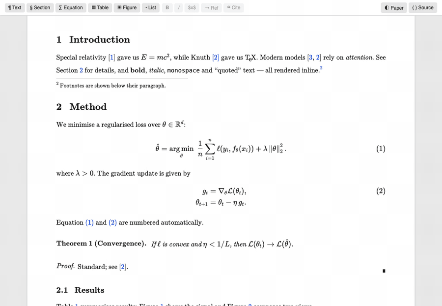
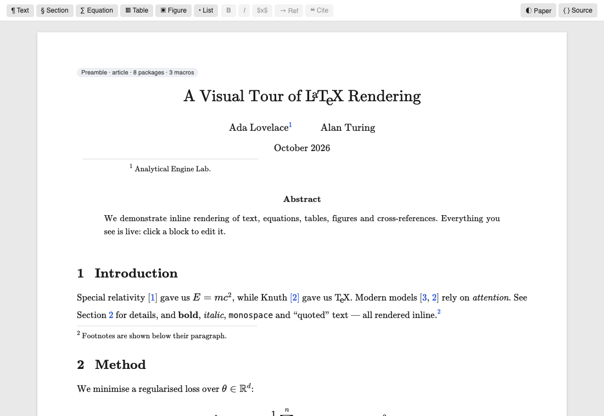

# Swan LaTeX Visual Editor

Write LaTeX the way you'd write a document. Text, equations, tables, figures,
citations and cross-references render inline, and you type directly into the
rendered page. Behind the scenes every keystroke becomes a small, precise edit
of your `.tex` source, so undo, save, git, LaTeX Workshop and your build all
keep working exactly as before.



> **Preview release.** The `.tex` file is always the source of truth and edits
> are minimal, but please keep your work under version control and
> [report anything odd](https://github.com/sammlapp/latex_visual_editor/issues).

## Install

- **VSCodium, Cursor, Windsurf, Gitpod and other Open VSX editors:** search for
  *Swan LaTeX Visual Editor* in the Extensions view.
- **VS Code:** download the `.vsix` from the
  [latest release](https://github.com/sammlapp/latex_visual_editor/releases/latest), then in the
  Extensions view choose **··· → Install from VSIX…** (or run
  `code --install-extension swan-latex-visual-editor-<version>.vsix`).

## Getting started

1. Open a `.tex` file.
2. Click the preview icon in the editor title bar (**Open Visual Editor to the
   Side**), or run **LaTeX: Open Visual Editor** from the Command Palette, or
   right-click the file → *Open With…* → *Swan LaTeX Visual Editor*.

To always open `.tex` files visually, add this to your settings:

```json
"workbench.editorAssociations": { "*.tex": "latexVisual.editor" }
```

## Editing

**Text.** Click into any paragraph, heading, caption, table cell, footnote or
the title and type. Characters that mean something in LaTeX (`% & # _ { } ~ ^`)
are escaped for you.

| Action | How |
| --- | --- |
| New paragraph / split paragraph | Enter |
| Join with previous paragraph | Backspace at the start |
| New list item / leave the list | Enter at the end of an item / on an empty item |
| Line break (`\\`) | Shift+Enter |
| Bold / italic (toggle) | ⌘/Ctrl+B, ⌘/Ctrl+I |
| Inline math | type `$` (or ⌘/Ctrl+M) |
| Any LaTeX command | type `\` |
| Undo / redo | ⌘/Ctrl+Z, ⇧⌘Z / Ctrl+Y (VS Code's normal history) |

**Citations and references.** Type `\cite{` (or `\citep{`, `\citet{`, …) or
click **❝ Cite**, and your bibliography appears as you type. Matching is by
whole words across keys, author names and title words, so `lapp opensoundscape`
finds *Lapp et al. (2023), "OpenSoundscape: …"*. Enter inserts the key, Tab adds
another. `\ref{` / **→ Ref** completes labels the same way.

**Math, figures, tables and everything else.** Click an equation, figure or
table (or inline math) to edit its source with a live preview. Hover any block
and click **`</>`** at its left to edit its full LaTeX source. Click a
reference or citation to jump to its target (⌥/Alt+click to edit it).

The toolbar inserts sections, equations, tables, figures (pick an image file)
and lists after the current block. **◐ Paper** toggles between your color
theme and a white page; **{ } Source** opens the LaTeX side by side, and the
visual view follows your cursor in the source.



## What renders

| Element | Support |
| --- | --- |
| Text | paragraphs, `\textbf`, `\emph`, `\texttt`, size and style switches, accents, quotes, dashes, `~`, footnotes, `\url` / `\href`, your own `\newcommand`s |
| Math | `$…$`, `\(…\)`, `\[…\]`, `$$…$$`, `equation`, `align`, `gather`, `multline`, `eqnarray`, `alignat` via KaTeX, with LaTeX-style numbering, `\nonumber`, `\tag`, preamble macros and `\DeclareMathOperator` |
| Tables | `tabular`, `tabularx`, `longtable`; column alignment, `\|` rules, `\hline`, booktabs, `\cline` / `\cmidrule`, `\multicolumn`, `\multirow` |
| Figures | `\includegraphics` for PNG, JPG, SVG, GIF and PDF (first page), `width` / `scale`, `\graphicspath`, subfigures, captions |
| References | `\label`, `\ref`, `\eqref`, `\autoref`, `\cref`; `\cite`, `\citep`, `\citet`, … from `.bib` files or `thebibliography`, with a numbered reference list |
| Structure | `\maketitle`, abstract, numbered sections and `\appendix`, lists, theorem-like environments, proofs, `\tableofcontents`, verbatim |

Anything the editor doesn't understand is shown dimmed rather than hidden, so no
content is lost.

## Known limitations

- Math is edited in a source popover rather than typed in place.
- Changing a table's structure (rows, columns, rules) uses the source editor.
- `\input` / `\include` files are shown as links rather than inline.
- EPS figures show a placeholder.

## Settings

| Setting | Default | Description |
| --- | --- | --- |
| `latexVisual.pageStyle` | `theme` | Initial page style: follow the color theme, or `paper` for a white page. |

## Development

```sh
npm install
npm run build              # bundle to dist/
npm run test:unit          # parser / renderer / completion tests
npm run test:browser       # drives the webview in Chrome with real keystrokes
npm run test:integration   # runs inside VS Code against test/fixtures/paper.tex
npm run package            # production .vsix
```

Press F5 in VS Code to launch an Extension Development Host with the sample paper.

## License

MIT. Bundles [KaTeX](https://katex.org) (MIT) and [PDF.js](https://mozilla.github.io/pdf.js/) (Apache-2.0); see
[THIRD_PARTY_NOTICES.md](THIRD_PARTY_NOTICES.md).
